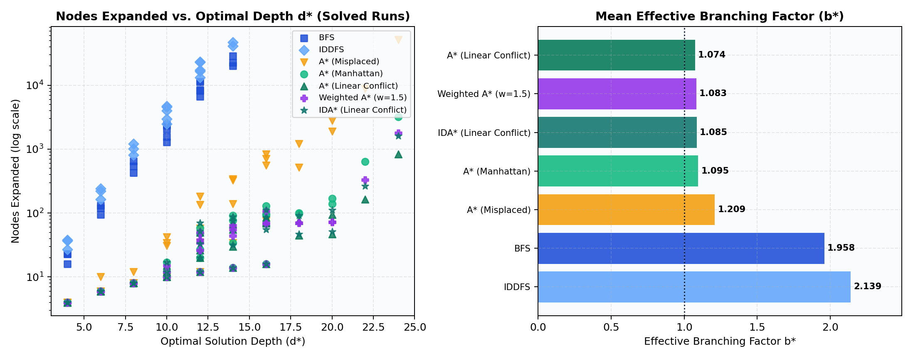
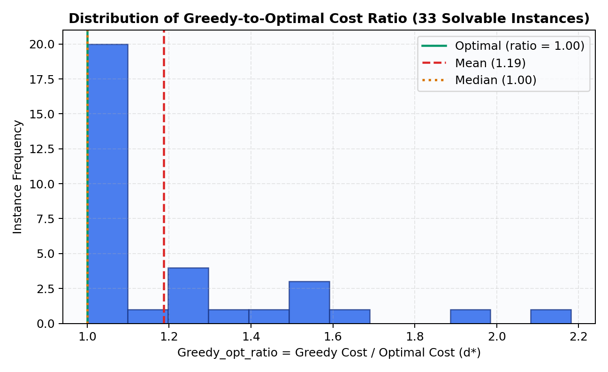
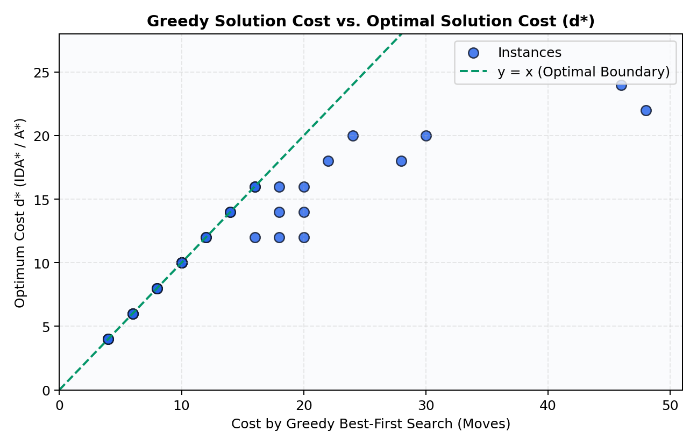
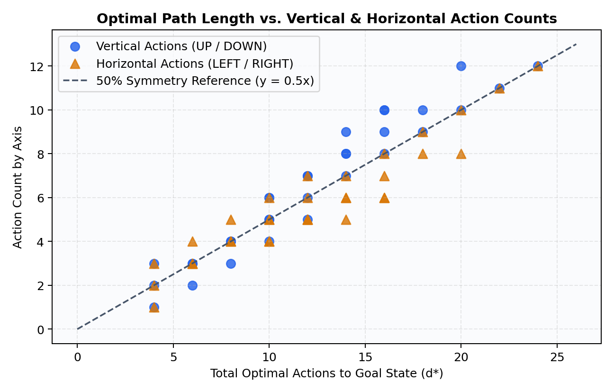
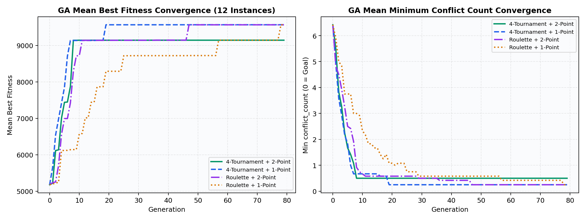

# Empirical Evaluation & Performance Report: 4×4 15-Puzzle

**Experiment Script:** [`python/evaluate_report.py`](../python/evaluate_report.py)
**Raw Dataset:** [`reports/evaluation_results.json`](evaluation_results.json)
**Benchmark Scope:** **33 solvable scramble instances** across scramble depths $d_{\text{scramble}} \in \{4, 6, 8, 10, 12, 14, 16, 18, 20, 22, 24\}$ (3 deterministic seeds per depth: `101, 202, 303`), plus a **48-run Darwinian GA ablation** across depths $\{6, 8, 10\}$ and 4 seeds (`11, 22, 33, 44`).

---

## 1. Effective Branching Factor ($b^*$) & Search Scaling

Using the bisection numerical solver (`effective_branching_factor(N, d*)`), we solve:
$$N + 1 = 1 + b^* + (b^*)^2 + \dots + (b^*)^{d^*}$$
where $N$ is the number of expanded nodes and $d^*$ is the exact optimal solution cost confirmed by IDA* (`Manhattan + 2×Linear Conflict`).

| Algorithm | Family | Solved / 33 | Solve Rate | Mean Cost | Mean Nodes (All) | Mean Nodes (Solved) | Mean Time (ms) | Mean $b^*$ | Max $b^*$ |
|---|---|---:|---:|---:|---:|---:|---:|---:|---:|
| **BFS** | Uninformed | 22 / 33 | 66.7% | 9.36 | 17,237.7 | 5,856.5 | 71.82 | **1.9585** | 2.0676 |
| **IDDFS** | Uninformed | 21 / 33 | 63.6% | 9.14 | 28,005.5 | 9,723.0 | 108.29 | **2.1388** | 2.2668 |
| **A\* (Misplaced)** | Informed | 33 / 33 | 100.0% | 12.30 | 2,138.9 | 2,138.9 | 17.05 | **1.2093** | 1.5016 |
| **A\* (Manhattan)** | Informed | 33 / 33 | 100.0% | 12.30 | 157.5 | 157.5 | 1.34 | **1.0952** | 1.3198 |
| **A\* (Linear Conflict)** | Informed | 33 / 33 | **100.0%** | **12.30** | **58.3** | **58.3** | **1.16** | **1.0743** | **1.2353** |
| **Weighted A\* ($w=1.5$)** | Informed | 33 / 33 | 100.0% | 12.61 | 94.6 | 94.6 | 1.85 | **1.0828** | 1.2833 |
| **IDA\* (Linear Conflict)** | Informed | 33 / 33 | **100.0%** | **12.30** | 89.8 | 89.8 | 2.87 | **1.0853** | 1.2768 |
| **Greedy Best-First** | Informed | 33 / 33 | 100.0% | 15.64 | 44.3 | 44.3 | 0.88 | **1.0829** | 1.2251 |
| **Hill Climbing (Steepest)** | Local | 12 / 33 | 36.4% | 7.33 | 6.1 | 7.3 | 0.15 | 1.0000 | 1.0000 |
| **Hill Climbing (Restart)** | Local | 14 / 33 | 42.4% | 9.00 | 23.5 | 9.0 | 0.56 | 1.0175 | 1.1752 |
| **Simulated Annealing** | Local | 1 / 33 | 3.0% | 4.00 | 1,061.0 | 4.0 | 8.09 | 1.0000 | 1.0000 |
| **Local Beam ($k=16$)** | Local | 33 / 33 | 100.0% | 12.79 | 152.1 | 152.1 | 2.84 | 1.3683 | 1.6451 |

**Key Takeaways:**
- Uninformed search (`BFS`, `IDDFS`) exhibits exponential growth with $b^* \approx 1.96$–$2.14$, exhausting the 40k–60k node budget once optimal depth exceeds ~14 moves.
- Tightening the heuristic from Misplaced Tiles ($h_1$) to Manhattan ($h_2$) to Manhattan + Linear Conflict ($h_3$) collapses mean $b^*$ from **1.209** to **1.095** to **1.074**, reducing mean node expansions from **2,138.9** to **58.3** (**97.3% reduction** vs. $h_1$, **63.0% reduction** vs. $h_2$) while preserving 100% optimality (`mean_path_cost = 12.30`).
- `IDA* (Linear Conflict)` matches exact optimal path costs (`12.30`) with $O(d)$ memory and $b^* = 1.0853$.

---

## 2. Greedy Best-First vs. Optimal Solution Analysis

Across all 33 instances, we evaluate `Greedy_opt_ratio = cost_by_greedy / optimum_cost (d*)`:

- **Min:** `1.0000`
- **Median:** `1.0000`
- **Mean:** `1.1868` ($\sigma = 0.3001$)
- **Max:** `2.1818`

### Frequency Distribution of `Greedy_opt_ratio`

| Ratio Interval | Instance Count | Percentage |
|---|---:|---:|
| `1.00` (Optimal) | 20 | 60.6% |
| `1.01 – 1.50` | 9 | 27.3% |
| `1.51 – 2.00` | 3 | 9.1% |
| `2.01 – 3.00` | 1 | 3.0% |
| `> 3.00` | 0 | 0.0% |
| **Total** | **33** | **100.0%** |

**Interpretation:** Although Greedy Best-First Search solves 100% of instances rapidly (`44.3` mean expansions, `0.88 ms`), ignoring path cost $g(n)$ leaves **39.4%** of solutions suboptimal—reaching up to **2.18×** optimal cost when greedy steps enter deceptive heuristic corridors.

---

## 3. Action-Axis Symmetry (`UP/DOWN` vs. `LEFT/RIGHT`)

Examining the exact optimal action sequences across all 33 instances (**406 total optimal actions**, mean $d^* = 12.30$):
- **Vertical actions (`UP`, `DOWN`):** `216` moves (**53.20%**, mean `6.55` per instance)
- **Horizontal actions (`LEFT`, `RIGHT`):** `190` moves (**46.80%**, mean `5.76` per instance)

**Interpretation:** Because the 4×4 grid is geometrically symmetric across rows and columns and scrambles are generated uniformly over legal non-backtracking moves, optimal solutions cluster tightly around the $y = 0.5x$ symmetry line, with minor variance driven by individual tile displacements.

---

## 4. Darwinian Genetic Algorithm Ablation (Selection & Crossover)

We evaluated 4 GA configurations (`population_size=50`, `sequence_length=24`, `num_generations=80`, `mutation_rate=0.18`, `elitism=2`) across 12 instances (`depths 6, 8, 10 × 4 seeds`):

| GA Configuration | Solve Rate | Mean Best Fitness | Mean Solved Path Cost | Mean Goal Generation (`conflict=0`) | Mean Final Conflict |
|---|---:|---:|---:|---:|---:|
| **4-Tournament + 1-Point** | **91.7%** (11/12) | **9,565.2** | **9.45** | **5.0** | **0.25** |
| **4-Tournament + 2-Point** | 83.3% (10/12) | 9,141.7 | 10.20 | 4.8 | 0.50 |
| **Roulette + 2-Point** | **91.7%** (11/12) | 9,563.7 | 11.09 | 9.6 | **0.25** |
| **Roulette + 1-Point** | **91.7%** (11/12) | 9,563.7 | 11.09 | 21.7 | **0.25** |

**Interpretation:**
- **4-Tournament Selection** applies stronger selection pressure than fitness-proportionate Roulette Wheel when all initial unsolved fitness scores sit near `~5000`: `4-Tournament + 1-Point` reaches `conflict_count == 0` in **5.0 generations** on average (**4.3× faster** than `Roulette + 1-Point` at **21.7 generations**) and finds shorter solutions (`9.45` vs. `11.09` steps).
- On deeper scrambles ($d \ge 16$), fixed-length open-loop GA suffers from **positional epistasis**: mutating or crossing over an early move alters every subsequent blank position, which explains why state-space informed search (`A*`, `IDA*`) remains vastly superior for hard $4 \times 4$ instances.
